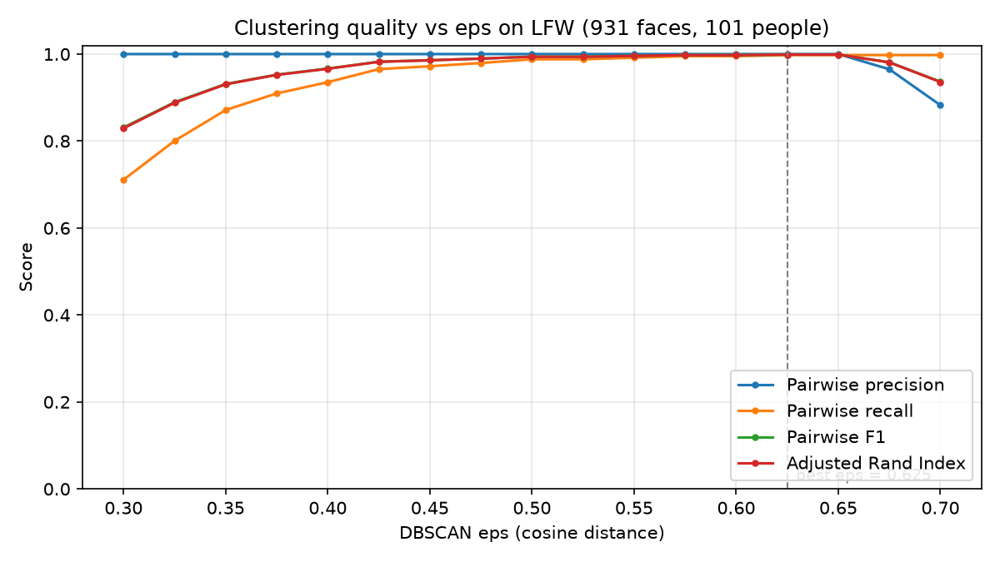

# FaceVault

Local-first face recognition: organize your photo library by person and run a
privacy-respecting home camera that recognizes and tracks household members.
Nothing ever leaves your computer.

> 🚧 Work in progress

## Planned features
- [x] Face detection and embeddings (InsightFace)
- [x] Incremental photo indexing
- [ ] Clustering faces into people
- [ ] Streamlit app to name, merge and search people
- [ ] Live camera with tracking and recognition
- [ ] Alerts for unknown people

## Setup
    python -m venv .venv
    source .venv/bin/activate
    pip install -r requirements.txt

## Privacy
All processing is local. No photos, faces or embeddings are uploaded anywhere.


## Face clustering

Once faces are detected and embedded, FaceVault groups them into people without
being told who anyone is. Each face is represented by a 512-dimensional
embedding, and faces whose embeddings are close together (cosine distance) are
assigned to the same cluster. Faces that fit no group are labelled as noise
(`cluster_id = -1`).

### Usage

```bash
python -m facevault.cluster tune                  # try several eps values
python -m facevault.cluster run --eps 0.5         # cluster and save to the DB
python -m facevault.cluster run --method hdbscan  # alternative algorithm
python -m facevault.cluster compare --eps 0.5     # DBSCAN vs HDBSCAN
python -m facevault.cluster export                # save sample crops per cluster
```

### Results

## Evaluation

Accuracy is measured on a subset of the [LFW dataset](http://vis-www.cs.umass.edu/lfw/):
100 people with up to 20 photos each (938 photos). Because LFW photos are labeled
with the person's name, every cluster can be checked against the true identity.
For each photo, the largest detected face is taken as the labeled face (931
faces; background faces are excluded).

```bash
python -m facevault.evaluate
```

### Metrics

- **Pairwise precision**: of all pairs of faces placed in the same cluster, the
  share that really are the same person. Low precision means different people
  were merged.
- **Pairwise recall**: of all true same-person pairs, the share that ended up
  in the same cluster. Low recall means a person was split up or left as noise.
- **Adjusted Rand Index (ARI)**: overall agreement between the clusters and the
  true identities (1.0 = perfect, 0 = random).

### Choosing `eps`



| eps   | Clusters | Noise | Precision | Recall | F1    | ARI   |
|-------|----------|-------|-----------|--------|-------|-------|
| 0.30  | 82       | 248   | 1.000     | 0.711  | 0.831 | 0.829 |
| 0.40  | 99       | 46    | 1.000     | 0.935  | 0.967 | 0.966 |
| 0.50  | 100      | 9     | 1.000     | 0.988  | 0.994 | 0.994 |
| **0.60** | **100** | **6** | **1.000** | **0.995** | **0.998** | **0.998** |
| 0.65  | 100      | 5     | 1.000     | 0.998  | 0.999 | 0.999 |
| 0.70  | 94       | 5     | 0.882     | 0.998  | 0.937 | 0.936 |

Precision stays at 1.000 up to `eps = 0.65`: no two different people are ever
merged. Increasing `eps` only improves recall, recovering faces that would
otherwise be split off or treated as noise. Beyond 0.65 precision falls sharply
as distinct identities start to merge.

The highest F1 is at 0.625, but FaceVault uses **`eps = 0.60`** by default: it
scores almost identically (F1 0.998) while staying further from the point where
identities merge, which leaves a safety margin for harder, real-world photos.

### DBSCAN vs HDBSCAN

| Method              | Clusters | Noise | Precision | Recall | F1    | ARI   | Time   |
|---------------------|----------|-------|-----------|--------|-------|-------|--------|
| DBSCAN (eps = 0.625)| 100      | 5     | 1.000     | 0.998  | 0.999 | 0.999 | 0.01 s |
| HDBSCAN             | 100      | 4     | 0.996     | 0.998  | 0.997 | 0.997 | 0.32 s |

Both methods recover all 100 identities. HDBSCAN reaches nearly the same
accuracy with no parameter to tune, which makes it a good fallback for new
photo collections; DBSCAN is slightly more precise and about 30x faster.

### Speed

Measured on a MacBook Air (CPU only):

| Step                               | Throughput                         |
|------------------------------------|------------------------------------|
| Indexing (detection + embedding)   | 11.7 photos/s (938 photos in 80.5 s) |
| Clustering (DBSCAN, 931 faces)     | 0.01 s                             |

Indexing is the bottleneck; clustering is effectively instant at this scale.

### Limitations

- LFW is an easy benchmark: mostly frontal, well-lit, centred faces of public
  figures. Accuracy on personal photo libraries (profiles, poor lighting,
  children, low resolution) will be lower.
- `eps` was chosen on the same data it is evaluated on, so these scores are
  slightly optimistic. A held-out set of different identities would give a
  fairer estimate.
- A cluster needs at least 3 faces, so people with fewer photos are left as
  noise.

  ## Live camera

```bash
python -m facevault.camera            # detect every 3 frames (default)
python -m facevault.camera --every 1  # detect on every frame
```

Runs face detection on the webcam at a 320×320 detection size, which is much
faster than the 640×640 used for photos and accurate enough at webcam
distances. Detection runs every N frames and the last boxes are reused in
between.

| Setting               | FPS (MacBook Air, CPU) |
|-----------------------|------------------------|
| Detect every frame    | 15                     |
| Detect every 3 frames | 30 (webcam maximum)    |

Detecting on every frame costs about 65 ms per frame on CPU. Running detection
every 3 frames doubles the frame rate to the webcam's 30 FPS cap, at the cost of
boxes lagging slightly behind fast movement between detections.

## Tracking

Without tracking, every frame is analysed on its own: names flicker and one
visitor could trigger hundreds of alerts. FaceVault's tracker (written from
scratch in `facevault/tracker.py`) gives each face a stable ID across frames.

1. Each frame, the IoU (overlap ratio) between every existing track and every
   new detection is computed in one vectorised NumPy operation.
2. The Hungarian algorithm (`scipy.optimize.linear_sum_assignment`) finds the
   one-to-one assignment minimising total cost `1 - IoU`. Unlike greedy
   matching, one track cannot take a detection another track needs more.
3. Matches with IoU ≤ 0.3 are rejected. Unmatched detections start new tracks;
   tracks unseen for more than 30 detection frames (about 3 s) are deleted.

Covered by unit tests with synthetic moving boxes (`python -m pytest`).

**Limitations and next step.** IoU matching assumes faces move little between
detections, so fast movement or a low frame rate can break a track, and two
faces crossing can swap IDs. The standard fix is SORT: a Kalman filter predicts
where each box will be in the next frame, and detections are matched against
those predictions rather than the last known position.

## Recognition

The camera recognises the people named in the photo organizer, which is where
the two halves of FaceVault connect.

1. **Centroids.** For each named person, the average of their normalised photo
   embeddings is computed and re-normalised into a single reference vector.
2. **Similarity.** Each tracked face is compared with every centroid using
   cosine similarity (a dot product, since all vectors are normalised).
3. **Voting.** A track is labelled with a name only if a majority of its last
   10 frames agree on that person with similarity ≥ 0.45, and at least 3 frames
   have been seen. Otherwise it is shown as "Unknown". Voting across frames
   stops the label flickering when a single frame is blurry or badly angled.

Known people are drawn in green, unknown faces in red. Press `r` in the camera
window to reload names after editing them in the app.

| Case                        | Cosine similarity |
|-----------------------------|-------------------|
| Known person, facing camera | ~0.80             |
| Known person, head turned   | ~0.XX             |
| Strangers                   | ~0.03             |

The threshold of 0.45 sits far from both groups, leaving margin for difficult
angles and lighting. With recognition enabled the camera runs at about XX FPS
(MacBook Air, CPU, detection every 3 frames).